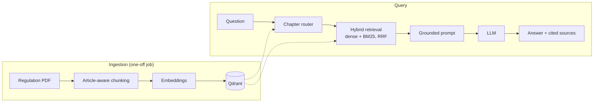
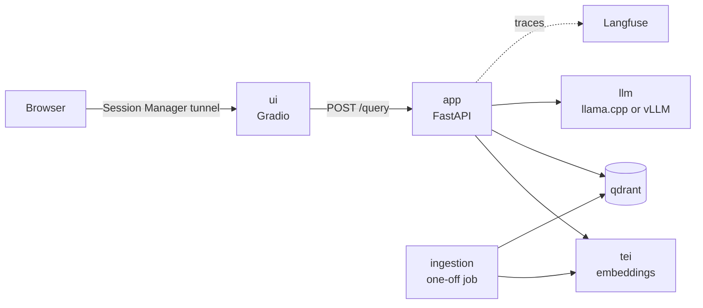
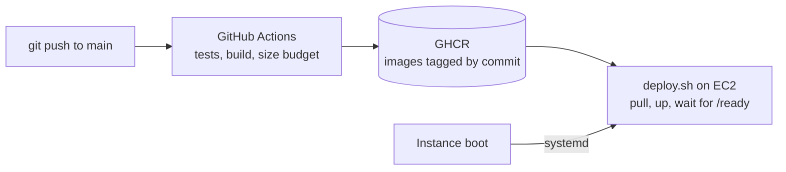

# RAG LLMOps: EU AI Act assistant

[](https://github.com/tinetor/rag-llmops/actions/workflows/ci.yml)
[](LICENSE)

Ask questions about the EU AI Act (Regulation (EU) 2024/1689) and get answers grounded in the text of the regulation, with every claim cited to its article. The system runs as a set of containers, is built and published by CI, and is deployed on AWS with one command.

<!-- TODO: add a 30-60 s GIF of the UI answering a question:

-->

## Highlights

- **Retrieval built for legal text.** Chunks never cross an article boundary, a router narrows the search to the most relevant chapters, and dense and BM25 results are fused with Reciprocal Rank Fusion.
- **Grounded answers.** Every claim cites an article. When the retrieved passages do not support an answer, the model returns a fixed escape phrase instead of guessing.
- **Each model on its own inference server.** Embeddings on Text Embeddings Inference, the LLM on llama.cpp (CPU) or vLLM (GPU). The API only orchestrates, so its image ships without PyTorch.
- **Build once, deploy many.** CI tests the code, builds the images once and publishes them to GHCR tagged with the commit. Deploying or rolling back is one command that takes a commit SHA.
- **No secrets on disk, no exposed app ports.** Secrets come from SSM Parameter Store through an IAM role. The API and UI bind to localhost and are reached through a Session Manager tunnel.
- **Measured, not assumed.** Retrieval is evaluated against a golden set as Langfuse dataset experiments, and every request is traced.

## Architecture

### RAG pipeline



### Services



| Service | Role |
|---|---|
| `ui` | Gradio chat interface. A thin client of the API, built and deployed as its own image. |
| `app` | FastAPI service: routing, retrieval, prompt building and generation. Exposes `/query`, `/health` and `/ready`. |
| `tei` | Text Embeddings Inference serving `BAAI/bge-base-en-v1.5`. Used by both ingestion and queries, so documents and questions are embedded the same way. |
| `qdrant` | Vector store, running in server mode with a persistent volume. |
| `llm` | OpenAI-compatible endpoint. llama.cpp serves a GGUF model on CPU; vLLM serves the same model on a GPU. Both answer at the same address, so the app does not change. |
| `ingestion` | One-off job that parses the PDF, chunks it, embeds the chunks and rebuilds the collection. Safe to run again. |

## How it works

**Ingestion.** The PDF is split at article headings first, then each article is split into chunks of up to 180 tokens with 10% overlap. No chunk crosses an article boundary, and each chunk carries its article, chapter and page numbers as metadata. Rebuilding the index drops and recreates the collection, so the job can be run again safely.

**Query.**
1. **Routing.** A dense search over the whole index returns 30 candidates. Each chapter is scored by its best candidate, and the top 2 chapters are kept.
2. **Retrieval.** Dense and BM25 search run inside those chapters, 15 candidates each, and their rankings are fused with Reciprocal Rank Fusion. The top 8 passages go to the prompt.
3. **Generation.** The prompt separates the instructions, the passages and the question, escapes them, and tells the model to treat passages as data, cite articles and use the escape phrase `Not covered in the provided material.` when the passages do not answer the question.
4. **Response.** The API returns the answer, a flag saying whether the model escaped, and the passages it used with their article, chapter and score.

Scope of v1: questions in English, answered from the articles of the regulation. Indexing the annexes is on the roadmap.

## Measured numbers

All numbers are from the CPU deployment (`m7i-flex.large`, 2 vCPU, 8 GB RAM) with the baseline LLM.

| Metric | Value |
|---|---|
| API image | 184 MB compressed, no PyTorch |
| Stack memory at idle | ~1.7 GB |
| Indexed chunks | 800 |
| Latency per question (p50 / p95) | TODO |
| Article hit@8, golden set | TODO |
| Article recall@8, golden set | TODO |

## Run it locally

Requirements: Docker with Compose. No GPU is needed.

```bash
git clone https://github.com/tinetor/rag-llmops.git
cd rag-llmops
cp .env.example .env          # optional: Langfuse keys for tracing

docker compose --profile cpu build
docker compose run --rm ingestion          # starts qdrant and tei, builds the index
docker compose --profile cpu up -d         # starts the LLM server, the API and the UI
```

Open the UI at http://localhost:7860, or ask the API directly:

```bash
curl -s -X POST http://localhost:8080/query \
  -H "Content-Type: application/json" \
  -d '{"question": "How is an AI system defined?"}'
```

The interactive API docs are at http://localhost:8080/docs.

On a machine with an NVIDIA GPU, use `--profile gpu` to serve the LLM with vLLM instead of llama.cpp.

## Deployment on AWS

### Delivery



- **CI** runs the unit tests, the UI tests and the image checks (the app must import inside the image, and the image must stay under 1 GB). Only if all of them pass, the API and UI images are pushed to GHCR, tagged with the commit SHA and `latest`.
- **`scripts/deploy.sh`** reads the secrets from Parameter Store, pulls the images, starts the stack and waits until `/ready` succeeds. It never builds on the server.
- **A systemd unit** runs the same script when the instance boots, so starting the instance is enough to bring the service up.

### Operations

| Task | Command |
|---|---|
| Deploy the latest image | `./scripts/deploy.sh` |
| Deploy or roll back to a commit | `./scripts/deploy.sh <commit-sha>` |
| Deploy and ask one question end to end | `SMOKE=1 ./scripts/deploy.sh` |
| Rebuild the index | `docker compose run --rm ingestion` |
| Open the UI from a laptop | `aws ssm start-session --target <instance-id> --document-name AWS-StartPortForwardingSession --parameters "portNumber=7860,localPortNumber=7860"` |

### Security

- **Secrets** (Langfuse keys) live in SSM Parameter Store as SecureString and are read at deploy time by the instance role. Nothing secret is stored in the repository or on disk.
- **The instance role** can read only this project's parameters, plus what Session Manager needs.
- **No application port is exposed.** The API and the UI bind to `127.0.0.1` and are reached through a Session Manager port-forwarding session, which needs no inbound rule.
- **Containers run as a non-root user**, and the API image contains only runtime dependencies.

## Design decisions

### Retrieval and generation

| Decision | Why | Trade-off |
|---|---|---|
| Chunks never cross an article boundary | The article is the legal and thematic unit of the regulation. Keeping it intact avoids separating an obligation from its condition or exception, and lets every passage be cited. | Articles vary a lot in length, so long articles are still split by size. |
| `BAAI/bge-base-en-v1.5` embeddings | Built for retrieval, small enough to run on CPU, and matches the English scope of the system. | A baseline choice, not a proven best. Larger models are candidates to compare. |
| Hybrid retrieval with RRF | Dense search finds paraphrases; BM25 finds exact legal terms and article numbers. RRF combines the two rankings without tuning weights or normalizing scores. | More computation per query. RRF scores are small by construction (about 1/61 at most per ranking with k = 60), so they rank but do not measure relevance. |
| Chapter router before retrieval | The regulation is organized by subject, so restricting the search to the most relevant chapters reduces noise from unrelated parts. | If the router picks the wrong chapters, the right passage never reaches retrieval. Measured below, with and without routing. |
| Fixed escape phrase | Gives the model an explicit way out instead of guessing, and the escape rate is a signal that can be monitored in the traces. | An escape means the retrieved context was not enough, not that the regulation does not cover the question. |
| Prompt-injection safeguards | Delimited sections, HTML-escaped inputs, and instructions to treat passages as data. The model has no tools, so a successful injection can only produce a wrong answer, not an action. Questions are limited to 2,000 characters. | Prompting is defense in depth, not a guarantee. |

### Infrastructure

| Decision | Why |
|---|---|
| Embeddings on TEI instead of inside the API | A dedicated inference server, the same for ingestion and queries. The API image stays small and has no PyTorch. |
| llama.cpp and vLLM behind the same endpoint | The model server is chosen by a Compose profile. The application code and configuration are the same on CPU and GPU. |
| `/health` and `/ready` as separate endpoints | Liveness says the process is up; readiness says the vector index is available. If the collection is missing, the API fails at startup with a clear message instead of failing at the first query. |
| Configuration overlay | One base config plus a small Docker overlay, selected by an environment variable. The same image runs locally and on AWS. |
| SSM Parameter Store for secrets | No `.env` file on the server and no secrets in the repository. Access is granted by the instance role. |
| GHCR as the registry | CI publishes with the workflow's own short-lived token. Moving to ECR needs OIDC federation from GitHub Actions to AWS; storing long-lived AWS access keys in CI was ruled out. |

## Evaluation

The LLM is deliberately small: `Qwen2.5-0.5B-Instruct`, quantized to 4 bits on CPU. It sets a baseline, so improvements to retrieval and generation can be measured against it.

- **Golden set.** 23 questions in `eval/golden_set.json`, each labeled with the articles that answer it. Some name the article ("What does Article 5 prohibit?"), others paraphrase it ("Which uses of AI are banned outright in the EU?").
- **Experiments.** `eval/evaluate_retrieval.py` and `eval/evaluate_generation.py` run as Langfuse dataset experiments, so every run is stored and comparable.
- **Metrics.** Article hit@8 (at least one expected article retrieved) and article recall@8 (fraction of expected articles retrieved).

| Experiment | Hit@8 | Recall@8 |
|---|---|---|
| Dense only | TODO | TODO |
| Hybrid (dense + BM25) | TODO | TODO |
| Hybrid + chapter router (default) | TODO | TODO |

## Observability

Every request is traced in Langfuse, with one span each for routing, retrieval and generation. The trace records the selected chapters, the retrieved passages, the full prompt, token usage and whether the model escaped. Traces are separated by environment (`production`, `development`, `evaluation`).

<!-- TODO: add a screenshot of one trace:

-->

## Testing

```bash
pip install -e ".[dev]"
pytest tests/unit            # API, pipeline, config, embeddings, retrieval
pytest tests/integration     # PDF loading, chunking, indexing (needs the PDF)
cd frontend && pytest        # UI
```

CI runs the unit and UI tests on every push and pull request, plus the image checks described above.

## Roadmap

- Benchmark the GPU profile (vLLM) against CPU for latency and throughput.
- Index the annexes.
- Add MRR and out-of-scope questions to the golden set, and generation metrics (faithfulness, answer relevance).
- Run the retrieval evaluation in CI as a quality gate.
- Run an end-to-end test of the Compose stack in CI.
- Move the registry to ECR with OIDC federation.
- Describe the infrastructure with Terraform.

## Repository layout

```
src/rag_llmops/     Python package: chunking, indexing, retrieval, prompts, generation, API
frontend/           Gradio UI, with its own Dockerfile and tests
configs/            Base config and Docker overlay
eval/               Golden set and Langfuse evaluation scripts
tests/              Unit and integration tests
scripts/deploy.sh   Deploy script used on the server and at boot
deploy/             systemd unit
compose.yaml        The whole stack, with cpu, gpu and tools profiles
Dockerfile          API image (multi-stage, non-root)
data/               Source PDF
```

## License

[MIT](LICENSE)
